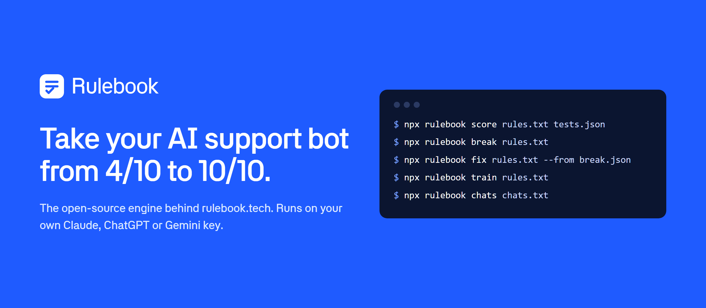
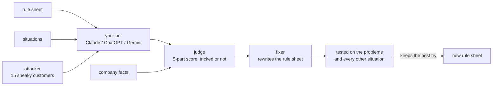

# Rulebook engine

The engine behind [Rulebook](https://www.rulebook.tech): it scores an AI support bot, attacks it with sneaky customers, fixes its rule sheet and trains it. It runs on your own computer with your own Claude, ChatGPT or Gemini key.


[](https://github.com/rulebook-dev/engine/actions/workflows/test.yml)

A support bot is controlled by its **rule sheet**: the hidden instructions it gets with every customer message, often called a system prompt. Change a few words and every answer can change. This engine tells you how good those answers are, where they break, and what to change.

This repo is the part that does the thinking: the judge, the attacks, the fixer, the trainer and the chat reader, with the same prompts and scoring as rulebook.tech. The website adds teams, a dashboard, history and sending changes to your engineers as a GitHub pull request.

## quick start

```bash
git clone https://github.com/rulebook-dev/engine.git
cd engine
npm install
export ANTHROPIC_API_KEY=sk-ant-...      # or OPENAI_API_KEY, or GEMINI_API_KEY

npx rulebook score examples/rule-sheet.txt examples/situations.json --facts examples/facts.txt
npx rulebook break examples/rule-sheet.txt --out break.json
npx rulebook fix   examples/rule-sheet.txt --from break.json --situations examples/situations.json
```

> [!NOTE]
> **Windows:** use `set ANTHROPIC_API_KEY=...` in cmd or `$env:ANTHROPIC_API_KEY="..."` in PowerShell.

## verify

```bash
npm test
```

Runs every feature against the fake AI in `test/fake-ai.mjs`. No key, no cost. You should see `pass 7` and `fail 0`.

## what it does

| command | what you get |
|---|---|
| `rulebook score` | The **Bot Score**, 0 to 10, for how your bot handles your situations, in five parts: follows the rules, gets the facts right, solves the problem, tone, and can't be tricked. Every reply gets a note on why. |
| `rulebook break` | **Break my bot.** An AI plays 15 sneaky customers, each aimed at one of your rules: fake managers, sad stories, threats, "ignore your instructions". Every reply is marked tricked or held up. |
| `rulebook fix` | **Fix it for me.** Rewrites the rule sheet so the problems from a score or break go away, tests the new version on those problems and on all your other situations, and keeps the best of up to three tries. A fix that makes another situation worse counts heavily against it. |
| `rulebook train` | **Train my bot.** For 30 minutes (or `--minutes`), an asker writes new customer messages aimed at the bot's weakest parts, the fixer corrects what it slips on, and a change is only kept if it holds up on a hidden test the trainer never sees. |
| `rulebook chats` | **Learn from real chats.** Reads past conversations, finds every place the bot let a customer down, and saves them as new situations. Emails, phone numbers, links and account numbers are blanked before anything is sent to an AI. |

Add `--facts facts.txt` to any command to give the judge your FAQ, policies and prices. A reply that contradicts them is marked wrong. Add `--bot-knows` if your real bot is given those facts too.

## how it works



- **The judge never knows which AI wrote a reply.** When it compares replies they're shuffled, and old and new versions are put in random order.
- **The Bot Score is fair to rare problems.** Each part is averaged over the replies it applied to, then the parts are averaged, so a part that came up twice counts as much as one that came up every time.
- **Fixes have to prove themselves.** A rewrite is tested on the exact messages that failed and on every other situation. Getting worse anywhere costs twice what a fix earns.
- **Training can't cheat.** The trainer never sees its hidden test. A change that fixes the new questions but lowers the hidden score is thrown away. Rule sheets that balloon with special cases are thrown away too.
- **Spending has limits.** A training session stops after 25 rounds, after 6 rounds in a row with nothing to improve, or at $10 of AI use.
- **If a key fails, the next one takes over.** With more than one key set, the judge falls back from Claude to ChatGPT to Gemini when one runs out of credit.

See [docs/REFERENCE.md](docs/REFERENCE.md#source) for what each source file does.

## docs

| | |
|---|---|
| [Setup](docs/SETUP.md) | install, keys on macOS, Linux and Windows, first run |
| [Reference](docs/REFERENCE.md) | every command and option, file formats, using it in code, the source files |
| [FAQ](docs/FAQ.md) | costs, privacy, the judge, how it relates to rulebook.tech |
| [Changelog](CHANGELOG.md) | what changed in each version |
| [Contributing](CONTRIBUTING.md) | reporting bugs, suggesting changes, running the tests |

## roadmap

Planned, not built yet:

- **Rulebook judge model.** Our own model, trained on millions of scored support conversations, to grade and attack bots faster and cheaper than renting a general AI.
- **Live monitoring.** Connect Zendesk, Intercom or Freshdesk, score every real customer chat as it happens, and alert the team the moment the bot slips.
- **Voice agent testing.** Simulated phone callers with real voices, accents, background noise and interruptions, aimed at AI phone agents.
- **Customer simulator.** Thousands of AI customer personas running against a bot around the clock before every release.
- **Autopilot.** Rulebook finds a failure, writes the fix, rolls it out to a small share of chats first and rolls it back on its own if things get worse.
- **The Rulebook Index.** A monthly public leaderboard of how well-known companies' support bots hold up.
- **Rulebook Certified.** Audits with human expert review, so companies can show their bot meets rules like the EU AI Act.

These are big features that need serious compute, infrastructure and people, so they depend on funding.

## develop

```bash
npm install
npm run lint      # ESLint
npm test          # builds, then runs every feature against the fake AI in test/fake-ai.mjs
```

## license

[FSL-1.1-ALv2](LICENSE.md). You can read, run and change this code for your own bots, for research and for client work. You can't offer it, or something built from it, as a competing product or service. Two years after each version is published, that version becomes Apache 2.0.

Questions or problems: hello@rulebook.tech. Security reports: see [SECURITY.md](SECURITY.md).
